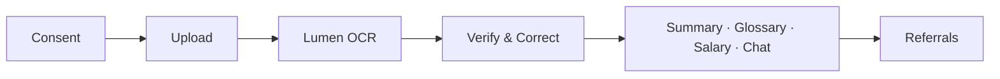

<div align="center">


# Linaw

**Understand your contract before you sign it.**

Upload a photo or PDF of an employment contract or quitclaim, check what the app read, and get a plain-language explanation in English, Filipino, or Taglish.


[The Problem](#-the-problem) •
[The Solution](#-the-solution) •
[How Lumen Is Used](#-how-lumen-is-used) •
[Getting Started](#-getting-started) •
[Project Layout](#-project-layout)

</div>

> [!IMPORTANT]
> **Linaw explains. It does not give legal advice.** It never says a contract is legal or illegal, or whether you should sign.

---

## 🧩 The Problem

Employment contracts and quitclaims are written in dense legal English, and workers are often asked to sign on the spot. Professional review is expensive and hard to reach, especially for **kasambahay**, **local employees**, and **OFWs**.

The result: people agreeing to terms they don't understand, such as low or unclear pay, excessive penalties, long hours, or giving up their rights in a quitclaim.

## 💡 The Solution

Linaw turns the document into something a worker can actually check.

| Step | What happens |
| :--: | :-- |
| 1️⃣ **Consent** | The user agrees to how the document is handled. |
| 2️⃣ **Upload** | JPG, PNG, or PDF (20 MB default, configurable). |
| 3️⃣ **Read** | Lumen OCR extracts text and per-field confidence. |
| 4️⃣ **Verify & correct** | The user compares the original page against the extracted salary, start date, term, hours, rest day, and penalty, fixes mistakes, and confirms. |
| 5️⃣ **Understand** | A short summary, glossary, deterministic salary breakdown, and **Ask Linaw** chat about the confirmed contract. |
| 6️⃣ **Get help** | Referrals to **DOLE**, **DMW**, **OWWA**, and **PAO**. |

**Also included:** worker-type guidance (kasambahay, OFW, local), contract comparison, and a no-contract questionnaire.



### 🛡️ Guardrails

- ✅ **Confirmed fields only.** The AI never sees unverified OCR text.
- 🧮 **No AI money math.** `frontend/src/lib/payroll.js` computes pay, deductions, and 13th-month pay deterministically.
- ⚖️ **Verified law only.** Chat is grounded in human-verified provisions from `backend/src/legal/`, filtered by worker type.
- 🔒 **No accounts, no app-side document database.** Working state lives in the browser tab and is cleared when it closes. Secrets stay on the server and document text is never logged.

---

## 🔆 How Lumen Is Used

Both integrations are called from the Node backend, so `LUMEN_API_KEY` and `LUMEN_API_SECRET` never reach the browser.

<details open>
<summary><b>📄 Lumen OCR</b> — <code>backend/src/services/lumenOcr.js</code> (proxied through <code>/api/ocr</code>)</summary>

<br />

- Uploads the raw PDF/JPEG/PNG with `POST /documents`, then polls `GET /documents/:id` until the read finishes.
- Fetches `GET /documents/:id/pages?IncludeWords=true` for words plus layout, and exposes Lumen's review endpoints for corrections.
- The frontend (`frontend/src/lib/extract.js`) converts pages into the six contract fields with confidence scores and source lines.

</details>

<details open>
<summary><b>💬 Lumen AI Chat</b> — <code>backend/src/services/lumenChat.js</code> (proxied through <code>/api/chat</code>)</summary>

<br />

- Opens one Lumen session per contract, then sends one message per question.
- The server builds that message (`chatMessage.js`): explanation rules, the user's confirmed fields (with corrected flags), and at most two verified law excerpts selected for the question and worker type (`legalRefs.js`). If verified law is unavailable, the answer explains the contract only.
- Lumen tags facts with `[C:key]` / `[L:id]`. The server keeps only citations to fields and law it actually sent, drops invented ones, and returns the answer with its basis.
- Timeouts, busy responses, and expired sessions are mapped to a consistent error envelope so the UI can offer a retry.

</details>

---

## 🚀 Getting Started

**Requirements:** Node.js 20+ and Lumen API credentials.

### Backend

```bash
cd backend
npm install
```

Create `backend/.env`:

```env
PORT=5000
SUPABASE_URL=
SUPABASE_SECRET_KEY=
LUMEN_OCR_BASE_URL=
LUMEN_CHAT_BASE_URL=
LUMEN_CHAT_INSTANCE_ID=
LUMEN_API_KEY=
LUMEN_API_SECRET=
```

```bash
npm run dev     # node --watch, reads .env
npm start       # production
```

The API runs at `http://localhost:5000`. OCR and chat return a clear "not configured" error if the Lumen values are missing.

> [!NOTE]
> Supabase is only used by the demo `/api/todos` route in `server.js`.

### Frontend

```bash
cd frontend
npm install
```

Create `frontend/.env`:

```env
VITE_SUPABASE_URL=
VITE_SUPABASE_PUBLISHABLE_KEY=
# VITE_API_URL=http://localhost:5000
```

| Command | Description |
| :-- | :-- |
| `npm run dev` | Start dev server at `http://localhost:5173` |
| `npm run build` | Production build |
| `npm run preview` | Preview the production build |
| `npm run lint` | Run the linter |
| `npm run check:i18n` | Keep locale + glossary keys in sync |

> [!TIP]
> CORS accepts any `http://localhost:<port>`, so Vite can fall back from 5173 to 5174 and still work.

---

## 🗂️ Project Layout

```
backend/     Express API: Lumen OCR/chat proxies, legal references
frontend/    React + Vite + Tailwind app: pages, i18n, extractors, calculators
figma-make/  Design prototype
.kiro/       Product/tech steering and specs
```

Product rules and specs live in `.kiro/steering/` and `.kiro/specs/`. Visual direction is in `DESIGN.md`.

---

<div align="center">

Made for Filipino workers 🇵🇭 — *linaw* means "clarity."

</div>